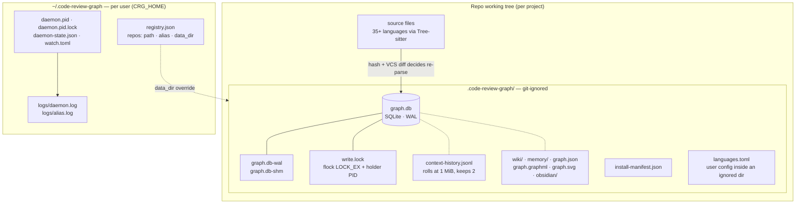
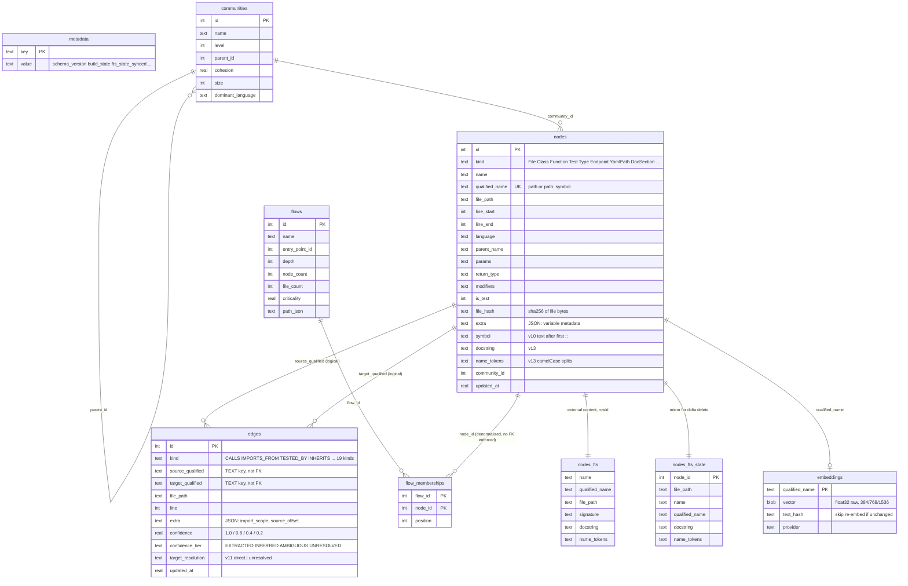
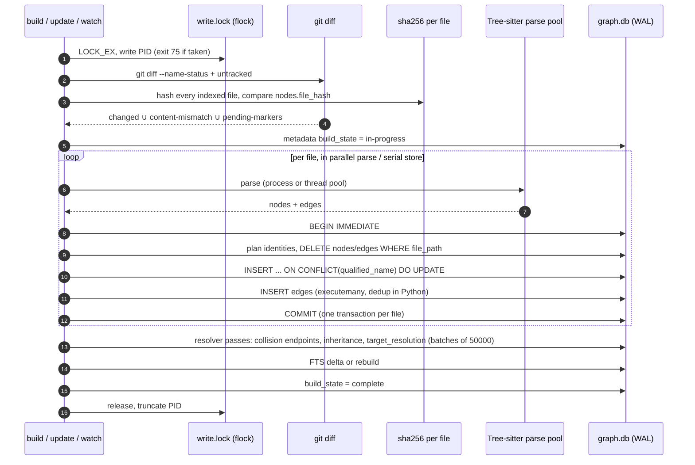
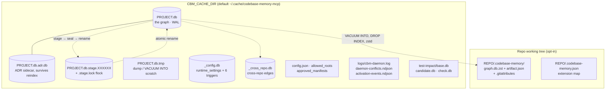
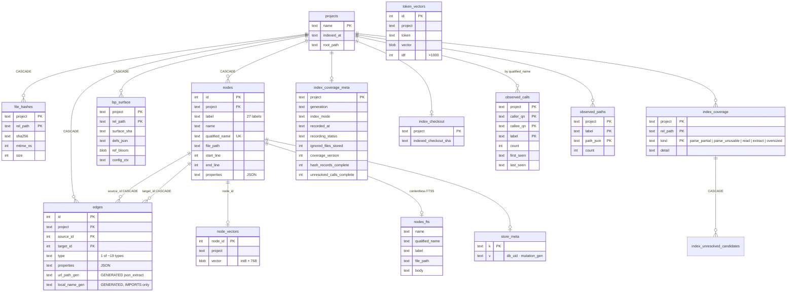
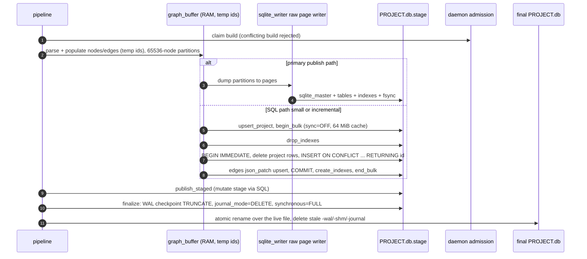

# Storage architecture: `codebase-memory-mcp` vs `code-review-graph`

Every claim below is traced to source. Verified directly:
`code-review-graph/code_review_graph/graph.py`, `migrations.py`, `search.py`, `embeddings.py`, `locking.py`;
`codebase-memory-mcp/src/store/store.c`, `internal/cbm/sqlite_writer.c`, `src/graph_buffer/`, `src/pipeline/`.

---

## 1. `code-review-graph` — one SQLite file per repository

### 1.1 Physical layout

- Data-dir resolution: registry `data_dir` → `CRG_DATA_DIR` → `<repo>/.code-review-graph/` (`incremental.py:675-762`).
- Sidecars removed on `mode=ro&immutable=1` reads (`graph.py:1146-1156`); **no** `-journal`, that would mean rollback-journal mode.
- The registry is JSON, not SQLite (`registry.py:20-63`).

### 1.2 ER model of `graph.db` (schema v15)

**Load-bearing details**

| Fact | Evidence |
|---|---|
| Edges are keyed by **qualified-name text**, not node ids → renames are reconciled in Python, no FK cascade | `graph.py:386-404` |
| `foreign_keys` is **never enabled** — the FKs declared by v6 were decorative, and v15 dropped those tables | `graph.py:1042-1048`, `migrations.py:668-698` |
| `nodes_fts` is **external-content** FTS5 (`content='nodes'`), `porter unicode61`; column order is BM25 weight order | `migrations.py:171-196` |
| **No triggers, no views.** FTS sync is application-driven: full `rebuild` or a rowid delta replayed via the mirror table | `search.py:154, 199-290`; grep for `CREATE TRIGGER`/`CREATE VIEW` = 0 hits |
| Delta is abandoned for a `rebuild` at `max(500, 0.35 × nodes)` | `search.py:106-107` |
| Schema version lives in **`metadata`**, not `PRAGMA user_version` (repo-wide grep: 0 hits) | `migrations.py:130-155` |
| PRAGMAs: WAL (writers only), `busy_timeout=5000`, `cache_size=-2000` (≈2 MB), `temp_store=FILE`. `synchronous` left at SQLite default **FULL** | `graph.py:1042-1048` |
| Vector search is a **linear scan** over `embeddings` per provider — no ANN index | `embeddings.py:1084-1100` |
| Migrations are **forward-only**; v15 is a *shrink* migration (drops 3 tables + 4 indexes) and needs a rebuild to roll back | `migrations.py:701-718`, `CHANGELOG.md:1469-1473` |

### 1.3 Write path

- `isolation_level=None` → **every statement outside an explicit transaction commits itself** (per-row WAL fsync). Batch transactions exist only for tests (`graph.py:1030, 1807-1832`).
- Incremental = union of three signals: VCS diff, sha256 content mismatch, and pending-re-parse markers. **mtime is never used** (`incremental.py:1377-1475, 3173-3420`).
- Dependents of a changed file are re-written with `store_file_edges` (edges only, node ids kept) — `incremental.py:3499-3512`.
- `build_state` tri-state (`in-progress` / `postprocess-pending` / `complete`) tells you whether a killed build needs a full rebuild or just `postprocess` (`build_state.py:41-82`).

### 1.4 Footprint

| Observation | Value |
|---|---|
| Dominant tables | `edges` (one row per call site) + `idx_edges_composite` (5 columns), `nodes_fts` + full mirror `nodes_fts_state` |
| Measured DB sizes | kubernetes/kubernetes **5.36 GB**, cli/cli **325.9 MB** (`CHANGELOG.md:1327-1339`) |
| Size cap / auto-prune / VACUUM | **none** — v15 leaves pages on the freelist by design (`migrations.py:678-690`) |
| Only subtractive op | `forget` — deletes rows, re-parses all referrers, re-runs the whole post-process pipeline (`forget.py:120-199`) |

---

## 2. `codebase-memory-mcp` — one SQLite DB per project, two writers, atomic publish

### 2.1 Physical layout

- One DB per **project name**, not per worktree; the project registry IS the `projects` table inside the DB (`store.c:365-369`).
- Cache root resolved in `platform.c:707-733`.
- The team artifact is `VACUUM INTO` → drop indexes → zstd `-3`/`-9` → `.zst` + `artifact.json`; import decompresses, reopens (recreating indexes), integrity-checks (`artifact.c:821-990`, `artifact.h:18`). Compression roughly **8–13:1**; a full Linux index is ~14 GB (README:429).
- **Three version numbers, deliberately independent**: artifact schema `2` (`artifact.h:18`), index format `5` (`store.h:39`), SQLite `schema_format 4` (`sqlite_writer.c:74-76`).

### 2.2 ER model

**Load-bearing details**

| Fact | Evidence |
|---|---|
| Edges are **integer-id FK** (`source_id`/`target_id` → `nodes.id`, `ON DELETE CASCADE`) — the opposite choice from CRG | `store.c:398-409` |
| `foreign_keys = ON` (real enforcement, unlike CRG) | `store.c:770` |
| Dedup key is a **composite with a generated column**: `UNIQUE(source_id, target_id, type, local_name_gen)` — because one IMPORTS statement can carry several local names | `store.c:378-409` + comment |
| Runtime traces are keyed by **qualified name, not node id**: node ids are reassigned on every reindex, so id-keyed observation would rot | `store.c:482-505` + comment |
| `nodes_fts` is FTS5 **contentless** (5 stored columns), `unicode61 remove_diacritics 2`; legacy DBs may still have the 4-column shape, so the code probes | `store.c:591-645` |
| Metadata tables are deliberately **outside** the graph: `lsp_surface`, `index_coverage`, `index_coverage_meta`, `index_checkout` are "input/metadata about the graph, not part of it" | `store.c:424-527` + comments |
| Vectors: **int8 × 768**, written by an 11-signal algorithmic encoder, **no model**; a 4-bit RaBitQ-style codec exists too | `semantic.h:39-40`, `rotsq.h:49-55`, `pass_semantic_edges.c:1411-1414` |
| Vector search = ordered scan + top-K with 5× prefilter — **no ANN index** | `store.c:908-940, 12912-12975` |
| `node_vectors` / `token_vectors` / `store_meta` are created **only by the raw page writer**, not by `init_schema`; on a SQL-path DB vector search degrades to "no vectors" | `sqlite_writer.c:2315-2322`, `store.c:12880-12890` |
| `CBM_PAGE_SIZE = 65536` for the raw writer (its own header comment still says 4096 — code wins); DBs via `sqlite3_backup` inherit the source page size | `sqlite_writer.c:7 vs :48`, `store.c:2628-2700` |
| PRAGMAs: `journal_mode=WAL`, `synchronous=NORMAL` (**OFF** during bulk, **FULL** at seal), `cache_size=-65536` (64 MiB), `mmap_size=64 MB`, `busy_timeout=10000`, `temp_store=MEMORY`, `journal_size_limit=256 MiB`, authorizer **denies ATTACH/DETACH** | `store.c:757-836, 1026-1036` |

### 2.3 Write path — in-memory buffer, raw page writer, atomic publish

- Writes are **never in place**: build to a stage file, seal it, `rename()` over the live DB. Readers keep serving the old file (a stale serving DB is preserved on failure — `INDEX_RESOURCE_LIMITS.md:97-112`).
- Incremental: per-file purge (`pipeline_incremental.c:1148`), FTS delta append (`pipeline_delta.c:1051`), and `SIMILAR_TO` / `SEMANTICALLY_RELATED` rebuilt **wholesale** (`pipeline_delta.c:1190-1203`).
- Freshness: the watcher polls git HEAD + dirty tree, interval `5 s + 1 s per 500 files`, capped at 60 s (`watcher.h:1-10`).
- Concurrency: single writer via `BEGIN IMMEDIATE` + 10 s `busy_timeout`; readers open `SQLITE_OPEN_READONLY`, skip write PRAGMAs, fall back to `immutable=1` on read-only filesystems; a process-wide mutex guards WAL first-access/recovery (`store.c:1208-1288`).
- Query layer: the Cypher subset is **parsed then executed through direct C store calls** (`cbm_store_find_nodes*`, `cbm_store_find_edges_by_*`) — it is *not* translated into one big SQL join. Ceilings: **100 000 rows** and **30 s** (`cypher.c:3249-3261`). Large walks switch to an in-RAM CSR adjacency layer (`graph_mem.h:1-30`).
- Resource guards fail closed and never publish a partial graph: `index_max_files`, `index_max_source_mb`, `index_max_rss_mb`, `index_max_duration_seconds`, single source file ≤ 512 MiB, artifact decompressed ceiling 64 GiB (`docs/INDEX_RESOURCE_LIMITS.md`, `artifact.c:20-23`).

---

## 3. Head-to-head

```mermaid
flowchart LR
    subgraph CRG["code-review-graph"]
        C1["1 SQLite file per repo<br/>graph.db"]
        C2["text-keyed edges<br/>qualified_name"]
        C3["in-place writes<br/>BEGIN IMMEDIATE per file"]
        C4["app-driven FTS + mirror table"]
        C5["schema_version row in metadata"]
        C6["linear vector scan in-DB"]
        C7["no size cap, no VACUUM"]
    end
    subgraph CBM["codebase-memory-mcp"]
        B1["1 DB per project + sidecars<br/>+ opt-in .zst artifact"]
        B2["id-keyed edges<br/>FK CASCADE, enforced"]
        B3["RAM buffer → stage → seal<br/>→ atomic rename"]
        B4["contentless FTS5<br/>+ delta append"]
        B5["user_version / schema_format<br/>+ artifact schema, independent"]
        B6["int8 vectors from an encoder<br/>linear scan + RaBitQ codec"]
        B7["documented limits, fail-closed"]
    end
    CRG -->|"smaller blast radius,<br/>simpler recovery"| CBM
    CBM -->|"crash-safe publish,<br/>multi-agent concurrency"| CRG
```

| Dimension | `code-review-graph` | `codebase-memory-mcp` |
|---|---|---|
| Engine | SQLite, WAL, page size default 4096 | SQLite 3.46 vendored; raw writer uses 65536 |
| Unit of storage | 1 DB per repo, `.code-review-graph/graph.db` | 1 DB per project + ADR sidecar + `_config.db` + `_cross_repo.db` |
| Edge identity | qualified-name **text** (no FK) | integer **node ids** with enforced `ON DELETE CASCADE` |
| Schema versioning | `metadata.schema_version` → 15 | SQLite `user_version` / `schema_format 4`, index format 5, artifact schema 2 |
| Migrations | forward-only, per-version transaction, idempotent, v15 shrinks the schema | `init_schema` `CREATE IF NOT EXISTS` + compatibility probes for legacy shapes |
| Write safety | `flock` file lock + `BEGIN IMMEDIATE`; a killed build leaves `build_state` to repair | stage → seal → atomic rename; partial graph never published |
| Bulk write optimisation | drop/rebuild targeted indexes per migration; `_UPDATE_BATCH=50 000` | `begin_bulk`: `sync=OFF`, 64 MiB cache, drop → insert → recreate indexes |
| FTS | external-content + mirror table, app-synced, delta or rebuild at 35 % | contentless FTS5, delta append, shape probe for legacy DBs |
| Vectors | float32 BLOB, provider-dependent dims, `text_hash` reuse | int8 × 768, self-contained encoder, IDF table, optional 4-bit codes |
| Footprint control | none built in; measured up to 5.36 GB | opt-in zstd artifact (8–13:1) + documented hard limits |
| Concurrency model | single process, serial stores, write lock with exit 75 | per-account daemon, admission barrier, single writer per DB, read-only replicas |

**The architectural split in one sentence:** CRG treats the DB as a **derived cache that can always be rebuilt from git** (cheap, text-keyed, in-place, no size discipline); CBM treats it as a **publishable artifact** (id-keyed, staged, sealed, compressible, shareable) — which is why CBM pays for a hand-written SQLite page writer and CRG does not.
