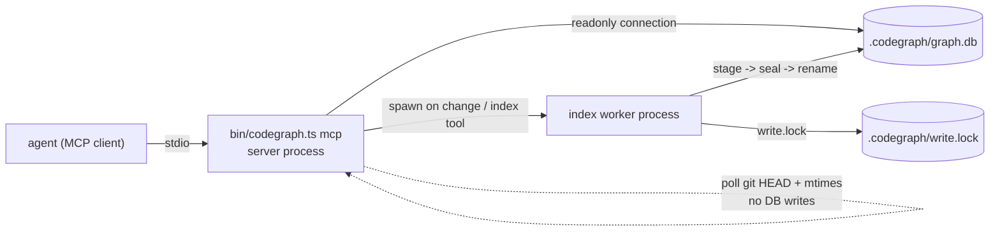
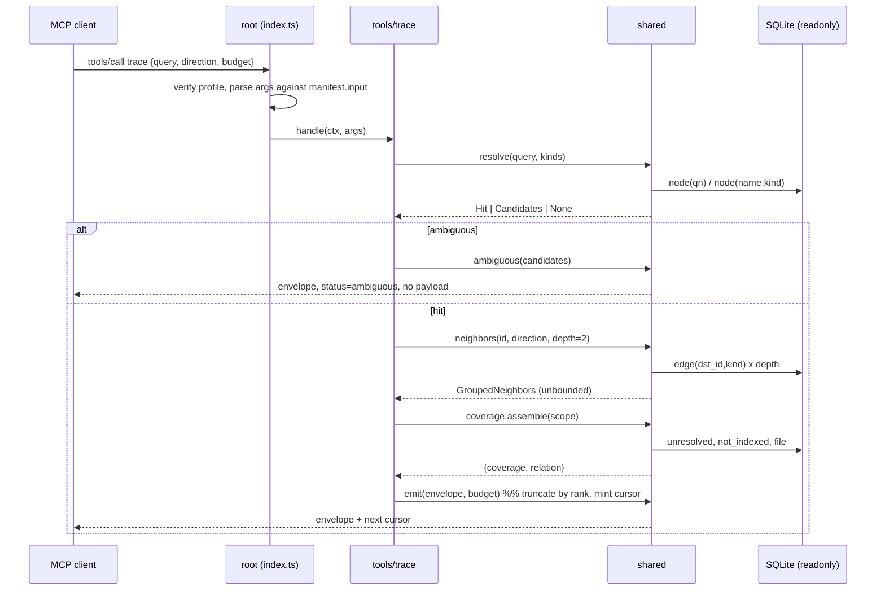
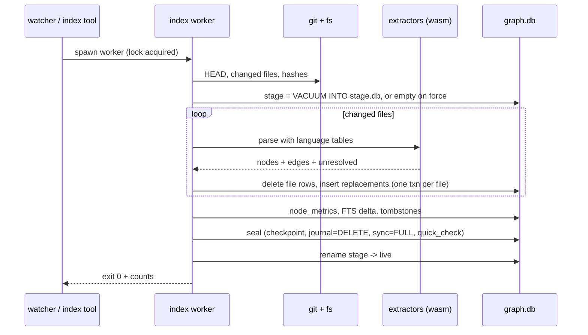

# Technical specification

Implementation shape for the server described in `DESIGN.md`, `TOOLS-SPEC.md` and `DATABASE.md`.
Runtime: **Bun + TypeScript**, strict module isolation, one module per tool.

**Status:** proposal, nothing implemented. Every runtime claim in §1 was probed on this machine — the
probe commands are given so they can be re-run.

---

## 1. Verified runtime baseline

Probed with `bun 1.4.4` (`~/.bun/bin/bun`, not on `PATH`).

| Capability | Result | Consequence for this design |
|---|---|---|
| `bun:sqlite` → SQLite version | **3.53.4** | modern SQL: generated columns, `VACUUM INTO`, JSON1 |
| FTS5 compiled in | **yes** — `pragma_compile_options` contains `ENABLE_FTS5`, `bm25()` works | the `search` design is viable without any extension build |
| `json_extract` | yes | `node.props` JSON column works as designed |
| FTS5 external content + `'rebuild'` | yes | `node_fts` + `node_fts_state` per `DATABASE.md` §3.5 |
| `VACUUM INTO '<file>'` | yes | seeds the publish stage from the live DB in one statement |
| `db.transaction(fn)` | yes | per-file writes inside one transaction |
| `new Database(path, { readonly: true })` | yes | reader connections |
| URI filenames `file:…?immutable=1` | **no** — `SQLiteError: unable to open database file` | CRG's immutable-reader optimisation is unavailable; readers use `readonly` only |
| `bun build --compile` | yes | single-file distribution, but **104 MB** for a hello-world |
| `package.json#/imports` map | **enforced** — an unlisted specifier fails to resolve | the module boundary can be a resolver guarantee, not a convention |
| relative imports across module dirs | **resolve fine** — the map does not block `../other-tool/x` | still needs a static check (§4) |
| `new Bun.Transpiler().scan()` | yes — returns `{imports:[{kind,path}], exports}` without executing | dependency-free, AST-accurate boundary test |
| npm registry reachable | yes | deps installable |
| `@modelcontextprotocol/sdk` | 1.32.2 | official TS SDK |
| `web-tree-sitter` / `tree-sitter-wasms` / `@vscode/tree-sitter-wasm` | 0.27.2 / 0.1.13 / 0.3.1 | parser options, §9 |
| `tree-sitter-language-pack` (CRG's parser source) | npm `latest` unresolvable — it is a **PyPI** package | CRG's exact parser stack cannot be reused; a WASM stack replaces it |

---

## 2. Repository layout

```
<name>/
├── package.json                # #/imports map = the module boundary
├── tsconfig.json               # strict; paths only for "#shared"
├── biome.json                  # style only, not the boundary
├── bin/
│   └── codegraph.ts            # single CLI entry: mcp (default) | index | status | worker
├── src/
│   ├── index.ts                # composition root: builds the server, registers tools
│   ├── shared/                 # LAYER 1 — kernel + engine (the ONLY cross-module import target)
│   │   ├── config.ts
│   │   ├── log.ts
│   │   ├── errors.ts
│   │   ├── envelope.ts
│   │   ├── budget.ts
│   │   ├── cursor.ts
│   │   ├── paths.ts
│   │   ├── store/
│   │   │   ├── db.ts           # open, pragmas, lock, stage/publish
│   │   │   ├── schema.sql
│   │   │   ├── migrate.ts
│   │   │   └── read/           # typed primitives: nodes, edges, metrics, coverage, files
│   │   └── domain/
│   │       ├── resolve.ts      # free text -> node | candidates
│   │       ├── neighbors.ts    # direction/depth expansion + grouping
│   │       ├── coverage.ts     # absence assembly
│   │       ├── risk.ts
│   │       └── diff.ts
│   ├── tools/                  # LAYER 2 — one directory per tool, private
│   │   ├── status/
│   │   │   ├── manifest.ts     # name, description, profile, input schema
│   │   │   ├── handler.ts
│   │   │   └── handler.test.ts
│   │   ├── trace/
│   │   ├── summary/
│   │   ├── search/
│   │   ├── impact/
│   │   ├── expand/
│   │   └── index/
│   └── indexer/                # LAYER 3 — the writer; never imported by tools
│       ├── worker.ts           # entry for `bin/codegraph.ts worker`
│       ├── discover.ts
│       ├── lang/
│       │   ├── registry.ts     # extension -> language
│       │   ├── types.ts        # class/function/import/call node types per language
│       │   └── custom.ts       # .codegraph/languages.toml
│       ├── extract.ts
│       ├── resolver.ts
│       ├── publish.ts
│       └── watch.ts
└── tests/
    ├── boundary.test.ts        # the module-isolation guard
    ├── envelope.test.ts        # every tool returns the contract
    └── budget.test.ts          # emit() never exceeds the budget
```

---

## 3. The module system

Three layers with a hard directional rule. "Module" below means a program unit with a `package.json`
`#`-specifier; only `shared` gets one.

| Layer | May import | May **not** import | Why |
|---|---|---|---|
| `shared` | `bun:*`, `node:*`, third-party | anything from `tools/` or `indexer/` | a kernel that depends on a caller is not a kernel; it would also create cycles |
| `tools/<name>` | `shared` only | any other `tools/<other>`, `indexer/` | this is the rule the user asked for: tools are private |
| `indexer` | `shared` only | `tools/` | the writer must not depend on the reader; tools trigger it by **process**, never by import |
| `src/index.ts` (root) | everything, explicitly | — | the composition root is the one place that knows all modules |

### 3.1 Why one module per tool

- **Blast radius.** A bug in `trace` cannot change `summary`'s ranking, because the only code they share is
  the kernel. The measured failure mode in CRG was the opposite: 30 tools sharing hand-tuned ceiling
  helpers, and the ceilings diverged three times on the same repo.
- **Reviewability.** Each module is ~150–400 lines: schema, policy, shaping. A reviewer reads one
  directory.
- **Deletability.** A tool with zero calls (the measured problem) is one `rm -rf` plus one line in the
  composition root — not an archaeology exercise.

### 3.2 The cost, stated honestly

Cross-tool sharing now has nowhere to go except `shared`, which can rot into a god module. §5 draws the
line and §4.3 makes promotion a deliberate, reviewable act.

---

## 4. Enforcement

Three mechanisms; the first two are verified on Bun 1.4.4.

### 4.1 Resolver map — the boundary for `#` specifiers

`package.json`:

```json
{
  "type": "module",
  "imports": {
    "#shared": "./src/shared/index.ts",
    "#shared/*": "./src/shared/*"
  }
}
```

Probed: `import … from "#shared"` resolves; `import … from "#tools/alpha/mod"` fails with
`Cannot find module '#tools/alpha/mod'`. Anything not listed is **unresolvable**, so a tool cannot import
another tool even if it tries.

### 4.2 Boundary test — the boundary for relative paths

Relative imports bypass the map (probed: `../alpha/mod.ts` resolved fine), so one test closes it:

```ts
// tests/boundary.test.ts  (shape, not implementation)
for each file under src/:
  const { imports } = new Bun.Transpiler({ loader: "ts" }).scan(await file.text())
  assert every path matches the layer's allowed set:
    shared/*    -> not tools/, not indexer/
    tools/*     -> #shared only (plus ./ siblings inside the same tool)
    indexer/*   -> #shared only (plus ./ siblings)
```

No lint plugin, no extra dependency: `Bun.Transpiler.scan()` gives structured import paths without
executing anything (verified). A boundary violation fails CI in milliseconds.

### 4.3 Promotion rule — when code moves into `shared`

A helper may enter `shared` only if **all four** hold:

1. used by ≥2 modules, or by a module and the indexer;
2. carries **no tool policy** — no defaults, no ranking, no output shaping (§5.3);
3. has no knowledge of a specific tool's argument names;
4. has a unit test that does not import any tool.

Otherwise the code stays in the module and is duplicated deliberately. Duplication of 20 lines beats a
shared layer that knows what `trace` means.

---

## 5. `shared/` specification

### 5.1 Files and their exported surface

| File | Exports (shape only) | Contract |
|---|---|---|
| `config.ts` | `AppConfig` — dataDir, repoRoot, budgets, limits, langOverrides; `loadConfig()` | resolved **once** at process start; no module reads `process.env` directly |
| `log.ts` | `log.{debug,info,warn,error}` → **stderr** JSON lines | never writes stdout (§11) |
| `errors.ts` | `AppError` with a closed `code` union | every thrown error crosses the boundary as one of these (§11) |
| `envelope.ts` | `Envelope<T>`, `ok()`, `ambiguous()`, `notFound()`, `fail()`, `bootstrapping()` | the only way to build a response; guarantees the 9 fields from `TOOLS-SPEC.md` §1.1 |
| `budget.ts` | `emit(envelope, budgetTokens)` | ranking-aware truncation + `next` cursor; the single size chokepoint (`DESIGN.md` §7.1) |
| `cursor.ts` | `sign(payload)`, `verify(token, {tool, argsHash})` | HMAC, stateless, generation-bound (`DATABASE.md` §8) |
| `paths.ts` | `normalizeRel`, `prefixBounds(prefix)`, `qn(path, scope, name)` | the only place path→qn formatting lives |
| `store/db.ts` | `openReader()`, `openWriter()`, `stage()`, `seal()`, `publish()`, `acquireLock()` | the transaction/publish protocol of `DATABASE.md` §5 |
| `store/read/*` | `findByQn`, `findByName`, `neighbors(id, dir, kinds)`, `members(id)`, `metrics(id)`, `coverageOf(paths)`, `census()` | typed SQL. **No ranking, no limits, no formatting** |
| `domain/resolve.ts` | `resolve(query, kinds) -> Hit \| Candidates \| None` | the ambiguity contract (`DESIGN.md` §8) lives here, once, for `trace`/`search`/`expand` |
| `domain/neighbors.ts` | `expand(seedIds, {direction, depth, kinds}) -> GroupedNeighbors` | BFS with per-hop index use; returns **grouped by edge+tier**, unbounded |
| `domain/coverage.ts` | `assemble(scope) -> {coverage, unresolved, relation}` | produces `eq` vs `gte` — the absence contract (`DESIGN.md` §6) |
| `domain/risk.ts` | `score(changed, impacted) -> {score, band, drivers[]}` | one formula, so `summary` and `impact` cannot disagree |
| `domain/diff.ts` | `changedSince(base) -> {files, removed}` | git + hash comparison (`DATABASE.md` §7) |

### 5.2 What `shared` deliberately does **not** export

- no `limit`/`maxResults`/`detail_level` knobs (budgets are applied by `emit`)
- no per-tool constants (each tool owns its defaults, in its `manifest.ts`)
- no registration (that is the composition root)
- no HTTP/UI surface, at all

### 5.3 The policy line

> `shared` may decide **what is true**. A tool decides **what to show**.

Concretely: `domain/neighbors` returns every neighbour it found, grouped, with tiers.
`tools/trace` chooses depth default 2, drops `external` nodes when over budget, and orders groups
`calls → tested_by → inherits → imports`.

---

## 6. Tool module anatomy

Every module exports the same three things, and the composition root is the only importer.

```ts
// src/tools/trace/manifest.ts   (shape, not implementation)
export const manifest = {
  name: "trace",
  description: "<the verbatim text from TOOLS-SPEC.md §3>",
  profile: "agent",                       // "agent" | "admin"
} as const;

export const input = {
  query:     { type: "string", required: true  },
  direction: { type: "enum", values: ["all","in","out"], default: "all" },
  kinds:     { type: "array", items: { type: "enum", values: [...] } },
  depth:     { type: "integer", default: 2, min: 1, max: 4 },
  budget:    { type: "integer", default: 3200 },
  cursor:    { type: "string" },
};

// src/tools/trace/handler.ts
export async function handle(ctx: ToolContext, args: TraceArgs): Promise<Envelope<TracePayload>>;
```

`ToolContext` (built once by the root, passed to every handler):

| field | type | Why it is injected rather than imported |
|---|---|---|
| `reader` | `GraphReader` | lets every tool be unit-tested against a fake reader with no database |
| `cursor` | `{sign, verify}` | bound to this generation; tools never see the HMAC key |
| `log` | `Logger` scoped to the tool name | log lines are attributable without every call site naming itself |
| `now` | `() => Date` | makes staleness and cursor expiry testable |
| `config` | `AppConfig` | a tool must not read `process.env` |

Rules for handlers:

1. **Return** an envelope; never throw. `throw` is reserved for genuine bugs and is caught by the root.
2. **Never** construct an envelope by hand — go through `envelope.ts`, so `read_status` and `coverage` can
   never be forgotten.
3. **Never** size-check manually — hand the payload to `emit()` with the requested budget.
4. **Never** open the database — the reader is injected.

---

## 7. Composition root

`src/index.ts` does exactly four things:

1. `loadConfig()`; resolve the repo root; open the reader; run the open-time guard
   (`DATABASE.md` §5: `root_mismatch` / `wrong_project_db` / `unsupported_filesystem` / `schema_too_new`).
2. Import the seven manifests explicitly, filter by profile (`agent` | `admin`), build the
   `ToolContext`, and register with the MCP SDK.
3. Start the watcher (if enabled) which **spawns** the indexer process on change.
4. Wire signal handlers to release the write lock and close the DB.

Explicit import list, no directory scanning: with seven tools, the registry is seven lines and the
dependency graph stays readable. (Directory scanning would also defeat §4.1, since every module would then
need to be resolvable.)

---

## 8. Processes and concurrency



| Decision | Choice | Reason |
|---|---|---|
| Indexing in-process? | **No** — spawned child (`bin/codegraph.ts worker`) | a WASM parser OOM or a panic kills the worker, not the MCP session. CBM ships a whole supervisor (restart caps, quarantine journal) for exactly this reason |
| Worker pool size | `min(cpus, 8)` parser threads inside the worker | CRG's default; matches the measured full-build time on the reference corpus |
| Server ↔ worker | stdin/stdout JSON lines, or exit code + stage file | the worker's only output contract is "did the stage publish" |
| Write lock | **create-exclusive file** (`wx`) containing PID + start time, mtime heartbeat | **Bun has no `flock`**; SQLite's own lock protects the DB, this only prevents duplicate work (CRG used `flock`; not available here) |
| Stale lock | PID dead, or heartbeat older than 60 s → reclaim and log | a killed worker must not wedge the repo |
| Readers during publish | their own handle keeps the previous generation | the `rename()` publish protocol (`DATABASE.md` §5) |
| Watcher | poll `git HEAD` + file mtimes every 2 s, debounce 500 ms | portable, no inotify/FSEvents dependency; `node:fs.watch` behaves differently across platforms |
| Cancellation | MCP `notifications/cancelled` → abort signal into the handler; the worker is killed on cancel | CRG checks cancellation at every `check_cancel` boundary |

---

## 9. Parser strategy

The single riskiest dependency. CRG's stack (`tree-sitter-language-pack`, native `.so` per language) is
**PyPI-only** and cannot be reused here.

| Option | Version | Pros | Cons |
|---|---|---|---|
| **A. `web-tree-sitter` + `tree-sitter-wasms`** | 0.27.2 / 0.1.13 | pure WASM: no native build, works on any platform Bun supports; ~40 grammars in the bundle | ~2–3× slower than native; grammar set is fixed by the bundle |
| **B. `@vscode/tree-sitter-wasm`** | 0.3.1 | maintained by VS Code, curated, versioned together | fewer languages than A |
| C. native `tree-sitter` node bindings | — | fastest | N-API per platform, rebuild on every Bun upgrade; unverified on Bun 1.4.4 |
| D. regex/heuristic extractors | — | zero deps | recall collapse; rejected |

**Recommendation: A**, with B as fallback for any grammar A lacks. Keep the language layer *data*, copied
from CRG's mechanism: an extension map plus four node-type lists per language
(`class`, `function`, `import`, `call`) — the node-vs-edge decision stays a table lookup, so adding a
language is a data change, not a code change.

v1 language set (12): python, typescript, tsx, javascript, go, java, rust, c, cpp, csharp, php, ruby —
plus `.codegraph/languages.toml` for user additions (`GRAPH-MODEL.md` rules: built-ins win, capped count).

### 9.1 Parser spike acceptance criteria (before any tool code)

1. All 12 languages parse without `ERROR` nodes on the reference corpus (`code-review-graph/`, 530 files).
2. p50 ≤ 4 ms/file, p95 ≤ 25 ms/file on this machine.
3. The four-table representation reproduces ≥95 % of CRG's node counts per language on the same corpus
   (CRG is the oracle: 13 955 nodes / 130 044 edges measured).
4. Memory ceiling: peak RSS ≤ 1 GB while parsing the reference corpus with 8 workers.

If A fails (1)–(4), fall back to B, then to a 6-language v1.

---

## 10. Data flow

### 10.1 A tool call



### 10.2 An index run



---

## 11. Errors, logging, stdout discipline

MCP over stdio uses **stdout for the protocol**. Any stray `console.log` corrupts the session.

| Rule | Enforcement |
|---|---|
| stdout is protocol-only | `console.log` banned by lint rule; the SDK owns stdout; a smoke test asserts a clean `initialize`/`tools/list` round-trip |
| all logs to **stderr**, JSON lines | `shared/log.ts`, the only logger |
| handlers return, never throw | caught in the root and converted to `envelope.fail(code)` |
| error codes are a closed union | `errors.ts`; adding one is a visible diff |
| worker failures surface via exit code + a `meta.consecutive_failures` bump | `status.health` reports them (`DATABASE.md` §5) |

Error codes used so far (from `DATABASE.md` §5 and the tool specs): `wrong_project_db`,
`unsupported_filesystem`, `schema_too_new`, `cursor_invalid`, `cursor_expired`, `cursor_mismatch`,
`budget_too_large`, `bootstrapping`, `not_found`, `ambiguous`.

---

## 12. Testing strategy

| Level | What it proves | Cost |
|---|---|---|
| **boundary** (`tests/boundary.test.ts`) | no module import escapes §3 | ms, no DB |
| **unit per tool** | policy: defaults, grouping, ordering, ambiguity handling — against a fake `GraphReader` | fast, no DB |
| **contract** (`tests/envelope.test.ts`) | every tool returns all 9 envelope fields; `eq` only when coverage complete and no unresolved rows | fast |
| **budget** (`tests/budget.test.ts`) | property test: for random payload sizes and budgets, `emit()` output ≤ budget + 10 % and always carries `total_relation` | ms |
| **cursor** | tampered/expired/mismatched cursors are refused, and `expand` cannot cross a generation | ms |
| **integration** | real `bun:sqlite` DB built from the reference corpus (`code-review-graph/`, 530 files) — the same fixture both parents were measured on | seconds |
| **absence** | for a symbol with zero callers *and* an unresolved call site, `trace` returns `gte` + the unresolved row; with coverage incomplete, `complete: false` | seconds |
| **regression vs oracle** | node/edge counts per language compared against CRG's measured numbers (`TOOL-OUTPUTS.md`) | one run |

The absence and regression tests are the two that matter: they are the contract the whole design exists to
protect, and the only ones with an external ground truth to compare against.

---

## 13. Tooling

```json
{
  "scripts": {
    "mcp":    "bun run bin/codegraph.ts",
    "index":  "bun run bin/codegraph.ts index",
    "dev":    "bun --watch run bin/codegraph.ts",
    "test":   "bun test",
    "typecheck": "tsc --noEmit",
    "lint":   "biome check src tests",
    "build":  "bun build --compile bin/codegraph.ts --outfile dist/codegraph"
  }
}
```

- `tsconfig.json`: `strict`, `noUncheckedIndexedAccess`, `exactOptionalPropertyTypes`,
  `verbatimModuleSyntax`, `paths` mapping `#shared` for the editor (Bun uses `package.json#imports`).
- Biome for style/format only. **The boundary is §4, not the linter** — a rule that lives in review is not
  a rule.
- CI: `typecheck` → `boundary` → `test` → `budget` → integration on the fixture.

## 14. Performance budgets

From `DATABASE.md` §9, restated as CI gates:

| Path | Target | Gate |
|---|---|---|
| `trace` p95 | < 40 ms | integration benchmark on the fixture |
| `search` p95 | < 60 ms | ditto |
| `summary(change)` p95 | < 120 ms | ditto, dominated by `git diff` |
| incremental publish (1 file) | < 300 ms | integration |
| full publish (530 files) | < 45 s | integration, informational |
| payload size | ≤ requested budget + 10 % | property test (this is the failure CRG had 3×) |

## 15. Distribution

| Option | Size | Rebuild per platform | Notes |
|---|---|---|---|
| `bun build --compile` | **104 MB measured** for hello-world; + ~1–3 MB per WASM grammar → estimate 130–160 MB | yes | single file, no Bun on the user's machine |
| npm package + `#!/usr/bin/env bun` | small | no | requires Bun installed (102 MB itself) |
| `bun install -g` from git | small | no | same requirement |

**Recommendation: ship the npm package first, add the compiled binary once the grammar set is fixed** —
compiling 40 WASM grammars into a binary is the step that makes the artifact large, and the language set
is still an open question (§9, 12 languages in v1).

## 16. Spikes, in order

| # | Spike | Passes when |
|---|---|---|
| S1 | ~~`bun:sqlite` FTS5 + JSON1 + VACUUM INTO~~ | **done in §1** — all available; URI/immutable is not |
| S2 | Parser: `web-tree-sitter` + `tree-sitter-wasms` on the 12 languages | §9.1 criteria 1–4 |
| S3 | Absence envelope end-to-end on the fixture | `eq`/`gte`/`not_indexed`/`stale` all reachable and asserted |
| S4 | Publish atomicity with a concurrent reader | a reader holding the old handle completes its query unchanged while a publish renames over it |
| S5 | Boundary enforcement in CI | a deliberate `../other-tool` import fails the build with a readable message |

S2 is the long pole and gates all extractor work; S3 gates `trace`, `summary` and `impact` together; S4
gates the watcher. Do them in that order — none of the seven tools should be written before S2 and S3 pass.

## 17. Open questions

1. **MCP SDK vs hand-rolled protocol.** `@modelcontextprotocol/sdk` 1.32.2 is TS-first and works on Bun;
   a hand-rolled stdio loop is ~200 lines and removes a dependency that historically breaks majors
   (`fastmcp<4` pinning in CRG). Recommend the SDK, with the tool registration isolated in the root so it
   can be swapped.
2. **Zod for schemas, or literal JSON Schema.** Zod gives TS types for free but doubles the dependency
   surface and produces schemas the model sees. The spec's args are simple (string/enum/int) — a literal
   JSON Schema plus one tiny validator may be leaner. Decide at S2.
3. **`bun:sqlite` statement caching.** `db.query()` caches prepared statements; the cache key (and its
   eviction) is undocumented. If unbounded statement growth appears in long sessions, wrap it in a bounded
   map in `store/db.ts`.
4. **WASM module lifetime.** `web-tree-sitter` parsers are per-language objects; keeping 12 resident costs
   memory, recreating per file costs time. Measure at S2; likely a bounded LRU keyed by language.
5. **Worker protocol.** Full JSON-serialised file results, or write results to the stage DB inside the
   worker and return only counts? The latter is what CBM does and it keeps the child's memory bounded —
   but it means the worker owns the writer, so the server can never index in-process without violating §3.
