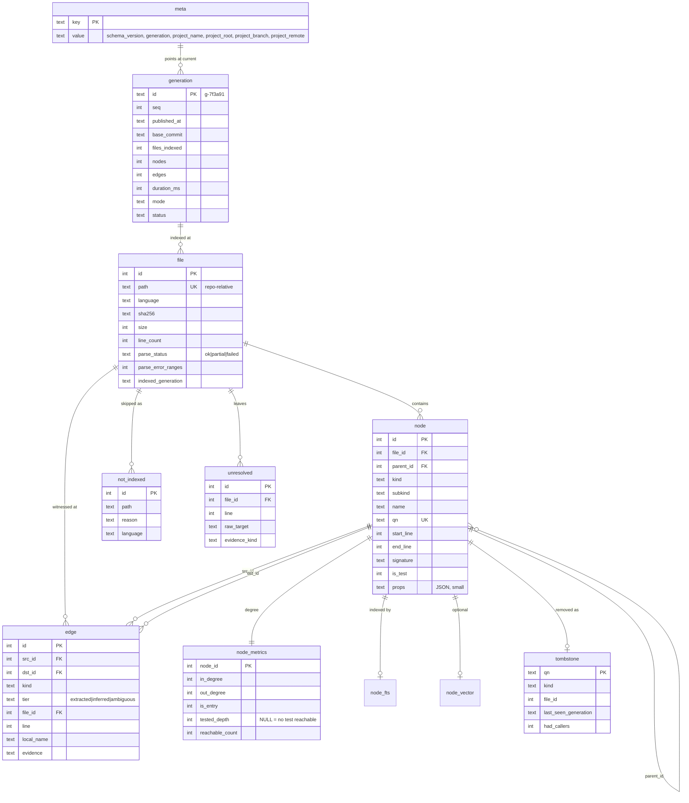

# Database design

**Sources compared throughout:** **CRG** = [tirth8205/code-review-graph](https://github.com/tirth8205/code-review-graph) — Python MCP graph server, 2.4.0, observed at commit `bbdda4b9e4b4` (branch `staging`). **CBM** = [DeusData/codebase-memory-mcp](https://github.com/DeusData/codebase-memory-mcp) — C/Go MCP graph server, `dev`, 164 grammars.

Companion to `DESIGN.md` (§11–12) and `TOOLS-SPEC.md`. Every table below exists because a specific tool
field requires it — §6 maps tool → query → index.

**Status:** proposal. The DDL in §3 is a spec, not a migration that has been applied anywhere.

---

## 1. Why the storage looks like this

Six decisions, each traceable to a measurement or a design contract.

| Decision | Rejected alternative | Reason |
|---|---|---|
| **Integer ids for edge endpoints** | CRG's text `source_qualified` / `target_qualified` | CRG's edges cost **492 B/row + 850 B of index = 1 342 B per edge** (measured on the 530-file corpus: 61 MB table + 105 MB of edge indexes for 130 044 edges). Id-keyed is ~50 B/row + ~64 B of index ≈ **14 MB for the same edges** |
| **Whole-file generation, published by rename** | per-row `generation` column | the DB file *is* the generation, atomically swapped. Stamping 14 k nodes and 130 k edges with an epoch doubles write volume to express a fact the file boundary already states |
| **`unresolved` in its own table** | CRG's dangling edge + `UNRESOLVED` tier; CBM's candidate sidecar | absence semantics (`DESIGN.md` §6) needs four distinct outcomes. A dangling edge cannot answer "I did not look there" |
| **No `folder` table** | materialised directory tree | a BINARY index on `file.path` serves prefix ranges (`path >= 'a/b/' AND path < 'a/b0'`). A folder table would need maintenance on every publish for one query shape |
| **Database inside the project (`.sangkar/`)**, not a shared cache | one cache dir keyed by project name + a registry | the file beside the code *is* the project identity, so no registry and no `project` argument exist. CBM spent **12.4 % of its calls on `list_projects`** re-discovering a path slug, and a deleted repo leaves an orphan in a cache. Costs and mitigations in §3.0 |
| **Denormalised `node_metrics`** | degree computed from `edges` per query | `search` returns `degree{in,out}` for every hit; `summary(repo)` needs hotspots; risk needs `is_entry` and `tested_depth`. N+1 scans of a 130 k-edge table per hit is the alternative |
| **No source text in the DB** | CRG/CBM both keep source-adjacent text | `expand(what="source")` reads the file from disk, and `file.sha256` already tells us whether the copy is current. Measured demand for source-in-payload was ~0 |

Consequence of the first row: our graph for the same corpus should land around **20–25 MB** instead of
CRG's 198 MB / CBM's 115 MB. Per-edge cost drops 20×; per-node cost is unchanged in kind (short qn,
small `props`).

---

## 2. Entity overview



---

## 3. Proposed DDL

> **Authoring.** This DDL is the design. In the implementation the modeled tables and indexes are declared in
> `src/shared/store/schema.ts` (Drizzle) and the SQL below is produced by `drizzle-kit generate`; the
> virtual tables (`node_fts`) and bulk maintenance statements stay hand-written SQL. Both streams are applied
> by one runner with one ledger — see `TECH-SPEC.md` §5.4.4. If the two ever disagree, the code is wrong.

### 3.0 Where the database lives

One database file per project, **inside the project directory**:

```
<repo-root>/.sangkar/graph.db        <- default
<repo-root>/.sangkar/graph.db-wal    <- WAL sidecars, never committed
<repo-root>/.sangkar/graph.db-shm
<repo-root>/.sangkar/write.lock      <- single-writer flock, outside the DB
<repo-root>/.sangkar/.gitignore      <- a single `*`, written on first index
<repo-root>/.sangkar/config.json     <- this tree's policy file: watch, watch_interval, telemetry,
                                        each omitting to <home>/config.json's default
```

Resolution order: `<root>/.sangkar/` → `--data-dir <path>`. A relative `--data-dir` resolves against
the repo root, which is `--repo-root` when given and otherwise the nearest ancestor of the working
directory holding `.sangkar/`, then the nearest holding `.git`, then the working directory itself.

Rules:

1. **Never modify a tracked file to make the directory ignored.** `.sangkar/.gitignore` containing one
   `*` makes git ignore everything inside without touching the repo's own `.gitignore`. (CRG converges on
   exactly this: one `*` line inside its own data-directory `.gitignore`, never an edit to the tracked one.)
2. **`.sangkar/` is excluded from discovery**, alongside `.git`. Forgetting this means indexing your own
   database, which grows every run.
3. **Refuse to run on a filesystem where WAL cannot work** (NFS, SMB, most FUSE, synced folders). Detect
   at startup and fail with a message that names `--data-dir`, rather than corrupting a `-wal` file.
4. **One database per working tree.** A linked `git worktree` gets its own `.sangkar/`, because its
   files really are different; the answering database is always reported in
   `status.payload.project.db_path`.

**`$SANGKAR_HOME` holds no graph.** The machine-level home — `$SANGKAR_HOME`, else
`${XDG_CONFIG_HOME:-$HOME/.config}/sangkar` — holds exactly the four files that belong to the
installation rather than to a tree: `config.json` (the installation's defaults), `sangkar.json` (the
registry of registered roots), `daemon.pid` (the daemon's singleton lock) and `daemon.log`. No
`graph.db` is ever resolved there, and the daemon opens no database at all (§5). The machine
`config.json` is written with its defaults by the first real run and read once per process; it holds
`watch`, `watch_interval`, `telemetry`, `daemon.host`, `daemon.port` and the two budgets
(`INDEXING-PIPELINE.md` §3.0).

`<repo>/.sangkar/config.json` is the one file a repository gains that is neither a graph nor a lock:
this tree's `watch`, `watch_interval` and `telemetry` settings, hand-editable, read by the daemon on
every reconcile tick and by the server once per process, each key omitting to the machine value and
degrading with one warning when it is malformed (`INDEXING-PIPELINE.md` §3.1).

Why in the tree rather than a shared cache dir: the database beside the code *is* the project identity, so
no registry and no `project` argument is needed (CBM spent 12.4 % of its calls on `list_projects`
re-discovering a path slug), the graph travels with the repo, and a deleted repo takes its database with
it instead of leaving an orphan in a cache.

### 3.1 Identity, generation, health

There is no `project` table. A one-row table with `CHECK (id = 1)` is a smell, and the database's own
location already supplies most of what it would hold. What must persist is **four identity keys in
`meta`**, written by the publisher (§5) from the tree it indexed:

| key | value | why it cannot be derived |
|---|---|---|
| `project_name` | repo basename at first index | display identity; a later rename should not rewrite it |
| `project_root` | absolute repo root at first index | the only guard against answering about the wrong tree after a `--data-dir` override, a copied database, or a moved checkout |
| `project_branch` | `git symbolic-ref --short HEAD` at publish | the branch the answer was built on; `""` when `HEAD` is detached or git cannot answer |
| `project_remote` | `git config --get remote.origin.url` at publish | which clone this is; `""` when the clone has no origin |

`project_name` and `project_root` are written **once**: the name is display identity, and the root is
the `root_mismatch` guard, so a re-index of a moved checkout has to report the mismatch rather than
erase it. `project_branch` and `project_remote` describe what the tree is on *now*, so each publish
refreshes them. Both git reads are **best-effort**: a non-zero exit, a missing binary or a timeout
records the empty string, and an identity the tree cannot supply never costs the generation.

A store published by a build that predates these keys keeps no identity row at all, so every one of
them reads as absent, and a reader maps absent **and** empty to `null` — never `""`, which would read
like a name that is blank rather than a fact the graph does not have. `status.project.branch` and
`.remote` answer `null` for such a store, and opening it logs `store.identity_unrecorded` instead of
failing: the guard has no root to compare, so the graph is served and the gap is named.

`project_root` is a *check*, not a lookup: on open it is compared against the database's location and the
current working directory, and a disagreement becomes `root_mismatch` in `read_status.stale_reason`
(moved tree) or a hard refusal (unrelated tree) — see §5. CRG carries the same guard as
`_assert_graph_matches_root`, because people copy databases between checkouts.

```sql
-- schema, identity and runtime state. `meta` is the only place a schema version lives.
CREATE TABLE meta (
    key   TEXT PRIMARY KEY,
    value TEXT NOT NULL
);
-- keys: schema_version, generation, generation_seq, indexer_state, rebuild_required,
--       consecutive_failures, project_name, project_root, project_branch, project_remote
-- not written by this build: last_publish_ms (derived from generation.duration_ms at read time),
-- last_stale_check_at, fts_synced, embed_dim — none of them is recorded state; §3.5 and §3.6
-- describe the paths that would write the last two.

-- publish history; the current generation is meta.generation (eq: MAX(seq))
CREATE TABLE generation (
    id             TEXT PRIMARY KEY,        -- 'g-7f3a91'
    seq            INTEGER NOT NULL UNIQUE,
    published_at   TEXT    NOT NULL,
    base_commit    TEXT,                    -- HEAD at index time; default diff base
    worktree_dirty INTEGER NOT NULL DEFAULT 0,
    files_indexed  INTEGER NOT NULL,
    nodes          INTEGER NOT NULL,
    edges          INTEGER NOT NULL,
    duration_ms    INTEGER NOT NULL,
    mode           TEXT    NOT NULL,        -- full | fast
    status         TEXT    NOT NULL         -- published | superseded
);
```

`generation` exists rather than a single `meta.generation` string because cursors bind to a generation
and `summary(change)` needs the previous generation's `base_commit` (`previous_generation` in the
`index` payload, `TOOLS-SPEC.md` §8).

### 3.2 Discovery and coverage (the trust objective)

```sql
CREATE TABLE file (
    id                INTEGER PRIMARY KEY,
    path              TEXT    NOT NULL,     -- repo-relative, '/' separated, no leading './'
    language          TEXT    NOT NULL,
    sha256            TEXT    NOT NULL,     -- content hash: freshness + staleness manifest
    size              INTEGER NOT NULL,
    line_count        INTEGER NOT NULL,
    parse_status      TEXT    NOT NULL,     -- 'ok' | 'partial' | 'failed'
    parse_error_ranges TEXT,                -- '12-12,38-38' when partial
    indexed_generation TEXT   NOT NULL,     -- which publish last wrote this file's rows
    UNIQUE (path)
);

-- every path the indexer looked at and did NOT index. Absence needs this:
-- without it, "no callers in X" cannot distinguish "empty" from "never parsed".
CREATE TABLE not_indexed (
    id       INTEGER PRIMARY KEY,
    path     TEXT NOT NULL,
    reason   TEXT NOT NULL,     -- grammar_unavailable | binary | ignored | size_cap
                                -- | unsupported_ext | symlink | parse_failed
    detail   TEXT,
    language TEXT,
    UNIQUE (path, reason)
);

-- call sites whose target did not bind. Stored, not dropped (DESIGN.md §6.1).
CREATE TABLE unresolved (
    id            INTEGER PRIMARY KEY,
    file_id       INTEGER NOT NULL REFERENCES file(id) ON DELETE CASCADE,
    line          INTEGER NOT NULL,
    raw_target    TEXT    NOT NULL,
    evidence_kind TEXT,         -- receiver_type_unknown | ambiguous | dynamic | missing_module (§7.1)
    evidence      TEXT,
    UNIQUE (file_id, line, raw_target)
);
```

`file.parse_status` and `not_indexed` together produce the `status` payload's per-language census
(`{language, files, parsed, failed}`) — the field CRG gets wrong by listing `xslt` and `liquid` as
supported while both grammars fail to load (`TOOL-OUTPUTS.md` findings).

### 3.3 The graph

```sql
CREATE TABLE node (
    id         INTEGER PRIMARY KEY,
    file_id    INTEGER NOT NULL REFERENCES file(id) ON DELETE CASCADE,
    parent_id  INTEGER          REFERENCES node(id) ON DELETE CASCADE,
    kind       TEXT    NOT NULL,   -- file|module|class|function|method|test|endpoint|import_alias
    subkind    TEXT,               -- struct|trait|enum|interface|constructor|lambda
    name       TEXT    NOT NULL,
    qn         TEXT    NOT NULL,   -- 'path::Scope.name'  (repo-relative, machine independent)
    start_line INTEGER NOT NULL,
    end_line   INTEGER NOT NULL,
    signature  TEXT,
    docstring  TEXT,               -- capped at index time; feeds FTS
    is_test    INTEGER NOT NULL DEFAULT 0,
    props      TEXT    NOT NULL DEFAULT '{}',  -- JSON: decorators, modifiers, route, http_method
    UNIQUE (qn)
);

CREATE TABLE edge (
    id         INTEGER PRIMARY KEY,
    src_id     INTEGER NOT NULL REFERENCES node(id) ON DELETE CASCADE,
    dst_id     INTEGER NOT NULL REFERENCES node(id) ON DELETE CASCADE,
    kind       TEXT    NOT NULL,   -- contains|defines|imports|calls|references
                                   -- |inherits|implements|tested_by
    tier       TEXT    NOT NULL,   -- extracted|inferred|ambiguous
    file_id    INTEGER NOT NULL REFERENCES file(id) ON DELETE CASCADE,
    line       INTEGER NOT NULL DEFAULT 0,
    local_name TEXT    NOT NULL DEFAULT '',   -- see note
    evidence   TEXT,               -- 'import:code_review_graph.graph' | 'same_file'
    UNIQUE (src_id, dst_id, kind, file_id, line, local_name)
);
```

`local_name` in the dedup key is not decoration: one `import x, y` statement produces two edges with
identical `(src, dst, kind, file, line)`. CBM solved the same problem with a **generated column**
(`local_name_gen`) because it could not change its DDL freely; we put the column in the key from the
start and avoid the generated-column machinery entirely.

`evidence` and `tier` are separate on purpose: the tier says *how sure*, the evidence says *why*. CRG
demotes endpoints and keeps `extra.claimed_endpoint`/`extra.inherited_endpoint` JSON; a plain
`evidence` string covers the same need for a fraction of the bytes.

### 3.4 Derived, computed once at publish

```sql
-- everything the query path would otherwise recompute over 130k edges
CREATE TABLE node_metrics (
    node_id        INTEGER PRIMARY KEY REFERENCES node(id) ON DELETE CASCADE,
    in_degree      INTEGER NOT NULL DEFAULT 0,
    out_degree     INTEGER NOT NULL DEFAULT 0,
    is_entry       INTEGER NOT NULL DEFAULT 0,   -- 1/0, computed from shape + filename
    tested_depth   INTEGER,                      -- min hops to a test node; NULL = none
    reachable_count INTEGER                      -- entry points only: nodes reachable
);

-- removed symbols, so summary(change) can report them without re-parsing the base commit
CREATE TABLE tombstone (
    qn                  TEXT PRIMARY KEY,
    kind                TEXT NOT NULL,
    file_id             INTEGER,
    last_seen_generation TEXT NOT NULL,
    removed_in_generation TEXT NOT NULL,
    had_callers         INTEGER NOT NULL DEFAULT 0
);
```

`tested_depth` is the schema-level answer to a problem both parents bolted on late: CRG added
`covered_via` / `covered_depth` / `covered_by` in v2.3.9 to distinguish "untested" from "tested through
a caller". Computing one `INTEGER` at publish and reporting `tested_depth` in `impact` removes the whole
category of ambiguity — and `test_gaps` becomes `tested_depth IS NULL OR tested_depth > 2` rather than a
graph walk.

`reachable_count` is the only expensive derived value (a BFS from entry points over `calls`). It lives
here because `summary(repo)` is a cold path that must not pay for a traversal, and because a publish
already holds the graph in memory.

### 3.5 Search

```sql
CREATE VIRTUAL TABLE node_fts USING fts5(
    name, qn, signature, docstring, props_text,
    content = 'node_fts_state',
    tokenize = 'unicode61 remove_diacritics 2'
);

-- external-content FTS cannot delete without the indexed values, so mirror them.
CREATE TABLE node_fts_state (
    rowid_     INTEGER PRIMARY KEY,   -- == node.id
    name       TEXT NOT NULL,
    qn         TEXT NOT NULL,
    signature  TEXT,
    docstring  TEXT,
    props_text TEXT
);
```

External-content + mirror rather than contentless (CBM) or plain (default): contentless cannot return
the matched text, and a plain FTS table duplicates the whole corpus. The mirror costs one extra write per
node and makes deletes O(1) per row; CRG converges on the same design (`nodes_fts_state`).

### 3.6 Optional: vectors

```sql
CREATE TABLE node_vector (
    node_id INTEGER PRIMARY KEY REFERENCES node(id) ON DELETE CASCADE,
    dim     INTEGER NOT NULL,
    vec     BLOB    NOT NULL      -- float32 or int8, format recorded in meta.embed_dim
);
```

Off by default (`DESIGN.md` §12). `meta.embed_dim` being `NULL` is the authoritative "no vectors"
signal, so `search` can report `mode: "bm25"` instead of silently degrading.

### 3.7 PRAGMAs

| Pragma | Build connection | Read connection |
|---|---|---|
| `journal_mode` | `WAL` | `WAL` (readers on the live file) |
| `synchronous` | `OFF` during bulk, `FULL` at seal | `NORMAL` |
| `foreign_keys` | `ON` | `ON` |
| `cache_size` | `-65536` (64 MiB) | `-16384` (16 MiB) |
| `mmap_size` | `268435456` | `268435456` |
| `busy_timeout` | `10000` | `10000` |
| `journal_size_limit` | `67108864` | — |
| `page_size` | default 4096 | — |

`page_size` stays at the default. CBM's 65 536 is only necessary because it hand-writes SQLite pages
(`sqlite_writer.c`); we use ordinary SQL, so the default plus WAL is both simpler and denser.

---

## 4. Index plan

Every index names the query it serves. No index without a caller.

| Index | Serves | Est. size (130k edges / 14k nodes) |
|---|---|---|
| `node` UNIQUE(qn) | `trace`/`expand` exact resolution, cursor stability | 2.3 MB |
| `idx_node_name_kind` on `node(name, kind)` | `trace` bare-name resolution, `search` fallback | 1.9 MB |
| `idx_node_file_line` on `node(file_id, start_line)` | `summary(change)` diff→node, `expand(members)` by file | 1.1 MB |
| `idx_node_parent` on `node(parent_id)` | `expand(what="members")` | 0.5 MB |
| `idx_node_kind` on `node(kind)` | `status` census, `search(kind=…)` | 0.3 MB |
| `idx_edge_dst_kind` on `edge(dst_id, kind, tier)` | `trace(direction=in)`, `impact` | 3.2 MB |
| `idx_edge_src_kind` on `edge(src_id, kind, tier)` | `trace(direction=out)`, `impact` | 3.2 MB |
| `idx_edge_file_line` on `edge(file_id, line)` | change→edge, purge on re-parse | 1.8 MB |
| `idx_edge_kind` on `edge(kind)` | FTS-independent kind scans, publish-time aggregation | 0.4 MB |
| `file` UNIQUE(path) | `status(paths)`, diff→file, staleness manifest | 0.1 MB |
| `idx_file_language` on `file(language)` | language census | 0.05 MB |
| `idx_not_indexed_path` on `not_indexed(path)` | `status(paths)` for never-indexed paths | small |
| `idx_unresolved_file` on `unresolved(file_id)` | absence assembly per query | small |
| `idx_metrics_entry` on `node_metrics(is_entry)` | `summary(repo)` entry points | 0.05 MB |
| `idx_metrics_tested` on `node_metrics(tested_depth)` | `test_gaps` | 0.05 MB |

Total index budget: **~15 MB** — versus CRG's measured **105 MB of edge indexes alone**, which it pays
because three of its four edge indexes repeat 100-byte absolute path strings.

Explicitly **not** created: an index on `edge(kind, src, dst, file, line)` (CRG's `idx_edges_composite`,
**52 MB** on its own — the single largest object in its database). It exists to make a UNIQUE constraint
cheap; here that role is served by two narrow covering indexes.

---

## 5. Publish and write path

```
stage:  copy live graph.db -> graph.db.stage.<rand>          (or start empty on forced full)
write:  BEGIN IMMEDIATE
          delete rows for each re-parsed file (file-scoped, via idx_edge_file_line / idx_node_file_line)
          insert nodes, edges, unresolved, not_indexed
          recompute node_metrics (degree from edges; tested_depth; entry BFS; reachable_count)
          update node_fts_state + node_fts (delta, or rebuild past 35 % of rows)
          append tombstones for nodes that disappeared
          insert generation row; set meta.generation
          write the project_* identity keys (§3.1)
        COMMIT
seal:   PRAGMA wal_checkpoint(TRUNCATE); journal_mode=DELETE; synchronous=FULL
        PRAGMA quick_check(1)
publish: rename(graph.db.stage.* -> graph.db); delete stale -wal/-shm
```

Rules carried over from CBM because they are the ones that survived concurrency:

- a failure at any step **discards the stage** — a partial graph is never published;
- readers hold their own handle and keep serving the previous generation until they re-open;
- one writer per repo, enforced by an `flock` on `<data-dir>/write.lock` (outside the DB), with
  `read_write_lock_holder` semantics so a contended caller can report *who* holds it (CRG's
  `{status: contended, holder_pid}` — the pattern that made its build failures diagnosable at all);
- `meta.indexer_state` + `consecutive_failures` are written even on failure, which is what
  `status.health` reports;
- the identity keys are written **inside the publish transaction**, in the same transaction that sets
  `meta.generation` — not when the database is opened. A publish is the only moment the tree's name,
  root, branch and remote are all known at once, and writing them there means a store carries the
  identity of the generation it serves or carries none of it: a stage that is discarded cannot leave
  a branch name behind that belongs to no publish. Opening the store *reads* them (§3.1, and the
  guard below); it never writes.

On open, before anything else:

```
resolve data dir  -> read meta.project_root
compare against   -> canonical(db).parent.parent   and   canonical(cwd)
  same tree            -> serve
  moved/copied tree    -> serve, but read_status.stale_reason = "root_mismatch" (the caller is told)
  unrelated tree       -> refuse: error.code = "wrong_project_db", name both roots, suggest --data-dir
  unsupported fs       -> refuse: error.code = "unsupported_filesystem"
  newer schema_version -> refuse: error.code = "schema_too_new"
```

Serving a graph that belongs to a different tree is the worst failure this design can produce — worse than
a stale graph, because staleness is disclosed and a mismatched graph is not. Hence a hard refusal rather
than a warning in the unrelated case.

**The guard runs per opened root, never per process.** A session that serves several repositories runs
the comparison above once for every store it opens, and the pool (`src/shared/store/pool.ts`) keeps
exactly one reader — a connection and its prepared-statement cache — per canonical root. A mismatch is
therefore refused for the entry it belongs to: the calls that select that repository answer
`wrong_project_db` and the others keep serving, instead of one tree's problem taking down a process that
serves N of them.

**The daemon never opens a write connection.** It holds `daemon.pid`, reads `sangkar.json` and each
`<repo>/.sangkar/config.json`, and spawns `sangkar worker` for every index run; the stage, the write
lock and the publish belong to that child alone. That is what keeps the single-writer rule above true
with one daemon and any number of sessions: `write.lock` is contended by workers, never by the
processes that read.

Delete-on-re-parse is file-scoped, never wholesale: `ON DELETE CASCADE` from `file` would be tempting,
but a file row survives re-parsing (it is the staleness manifest), so rows are deleted explicitly by
`file_id`. The cascade is the safety net for rows that outlive their file (deleted files, `index` repair).

---

## 6. Query patterns — the proof that the schema is sufficient

| Tool call | Query shape | Indexes used |
|---|---|---|
| `status()` | `SELECT` from `meta` (identity, generation, health), latest `generation`, `GROUP BY language` over `file` + `not_indexed` | `idx_file_language`, `file(path)` |
| `status(paths=[p…])` | per path: `file` rows with `path = p` or prefix range; plus `not_indexed` for the same range | `file(path)`, `idx_not_indexed_path` |
| `trace(q)` — resolve | `node WHERE qn = ?` → else `node WHERE name = ? AND kind IN (…)` | `node(qn)`, `idx_node_name_kind` |
| `trace(q)` — neighbours | two queries: `edge WHERE dst_id IN (…) AND kind IN (…)` and `edge WHERE src_id IN (…)…`, depth expanded per hop | `idx_edge_dst_kind`, `idx_edge_src_kind` |
| `trace(q)` — absence | `SELECT` from `unresolved WHERE file_id IN (…)` plus `not_indexed` prefix check | `idx_unresolved_file`, `idx_not_indexed_path` |
| `summary(change)` | changed paths (git + hash compare) → `file`/`node` by path → `node_metrics` for degree | `file(path)`, `idx_node_file_line` |
| `summary(change)` removed | `tombstone WHERE removed_in_generation = ?` | `tombstone(qn)` + seq scan of a tiny table |
| `summary(repo)` | `node_metrics WHERE is_entry = 1`, top-N by `in_degree+out_degree`, `GROUP BY language` | `idx_metrics_entry`, `idx_metrics_tested` |
| `search(q)` | FTS5 `MATCH` → `node` join → `node_metrics` for degree | `node_fts`, `node_metrics` PK |
| `search(q, path=p)` | as above plus `file.path` prefix join | `file(path)` |
| `impact(paths)` | same traversal as `trace`, plus `node_metrics.tested_depth` and `is_entry` per hit | as `trace` |
| `expand(members)` | `node WHERE parent_id = ?` | `idx_node_parent` |
| `expand(edges)` | both edge directions for one id | `idx_edge_*_kind` |
| `expand(coverage)` | `file` + `not_indexed` prefix range | `file(path)`, `idx_not_indexed_path` |
| `expand(source)` | **no query** — read the file from disk, verify `sha256` | `file(path)` |

Every tool is answerable from these tables with one index per access path. No tool needs a joined
aggregate over more than two tables, which is what keeps the p95 latency target reachable (§9).

---

## 7. Absence semantics, implemented

`DESIGN.md` §6 defines four outcomes. Here is how the schema produces each without inference:

| Outcome | Computed from |
|---|---|
| **absent** | `coverage.complete = true` **and** `total = 0` **and** `SELECT 1 FROM unresolved WHERE file_id IN (queried files)` returns nothing **and** `meta.generation` is fresh |
| **unresolved** | the `unresolved` count for the queried node's file set > 0 → `total_relation: "gte"`, rows surfaced in `payload.unresolved` |
| **out of scope** | any queried path matches `not_indexed` (or has no `file` row at all) → `coverage.complete = false`, `not_indexed[]` populated |
| **stale** | live `sha256` of the queried files ≠ `file.sha256`, or `base_commit` ≠ `HEAD` |

The `total_relation` field is therefore *derivable* from the tables, not a number the code decides to
print. That is the property that makes the invariant testable: a CI test can assert that every
`total_relation = "eq"` response has an empty `unresolved` set and complete coverage for the same scope.

### 7.1 The evidence kinds this build writes

`evidence_kind` is the bind pass's claim about *why* a site stayed unbound, and it is a closed set of
four (`BIND_EVIDENCE_KINDS`). Each one asserts something different about the site, which is what lets
the read side bucket the row without re-reading the source:

| `evidence_kind` | what the kind claims |
|---|---|
| `receiver_type_unknown` | the site wrote a receiver, and the bind pass could not establish its type — the candidates may differ by type, which is exactly the fact that is missing |
| `ambiguous` | more than one node fits the name, and nothing in the site chooses between them; a spurious edge is worse than a missing one, so the row is recorded instead of a guess |
| `dynamic` | the site offers nothing a static resolver can bind: an extractor site with no name at all, or an import specifier this resolver was never meant to see (a bare package, a `node:`/`bun:` builtin, a `#` tsconfig alias) |
| `missing_module` | a **relative** specifier matched no file in the tree — a broken import, not a module from outside it; recording it as `dynamic` made a real defect indistinguishable from an out-of-tree import |

An `ambiguous` **import** row keeps the competing paths in `evidence`, after the specifier token:

```text
import:./x.js candidates: src/x.ts | src/x/index.ts
```

The reader cuts the specifier at the first space, so the appended list can never be read as part of the
module path; a `missing_module` row appends `(no file matched)` the same way. The specifier alone
decides an import's read-side bucket (`src/shared/domain/unresolved.ts`), so changing the evidence
kind can move a row into the `material` count but never into a different bucket.

## 8. Cursors without a table

A cursor is **signed and stateless**: no `cursor` table, no server memory.

Contents (opaque to the client): `{generation, tool, args_hash, position, issued_at}` + HMAC.

Validation on use:

1. HMAC valid → else `error.code = "cursor_invalid"`.
2. `generation` == current → else `cursor_expired` with `hint: "re-run the original call"`.
3. `tool` + `args_hash` match the resuming call → else `cursor_mismatch`.

`generation` in the cursor is why the generation must be a stored, monotonic value. It also makes
pagination **stable**: within one generation, the ordering key (`rank, node.id`) never changes, so a page
boundary cannot skip or duplicate a row — the failure CRG's offset paging has and CBM works around by
requiring "all other arguments identical".

## 9. Size and latency budget

Projection for the reference corpus — the CRG repository named above at commit `bbdda4b9e4b4`
(530 files, 14 k nodes, 130 k edges) — with the measured CRG/CBM
figures for contrast:

| Object | Ours (est.) | CRG (measured) | CBM (measured) |
|---|---|---|---|
| `edges` table | ~7 MB | 61 MB | — (in 115 MB total) |
| edge indexes | ~9 MB | 105 MB | — |
| `nodes` | ~3 MB | 10 MB | — |
| FTS + mirror | ~4 MB | 8 MB | — |
| metrics / tombstones / coverage | ~1 MB | n/a | — |
| **total** | **~24 MB** | **198 MB** | **115 MB** |

That ~24 MB sits **inside the repository** (§3.0), so it is part of the working tree's disk footprint: it
shows up in `du`, in backups, and in any tarball of the checkout. 24 MB is tolerable; CRG's 198 MB in the
same place is not. If a real index ever exceeds ~2 % of repository size, `status.health` should say so.

Targets:

| Metric | Target | Why |
|---|---|---|
| `trace` p95 | < 40 ms | 2 hops, ≤4 indexed lookups per hop |
| `search` p95 | < 60 ms | FTS5 + metrics join |
| `summary(change)` p95 | < 120 ms | dominated by `git diff`, not by SQL |
| publish (incremental, 1 file) | < 300 ms | file-scoped delete + metrics recompute for the touched subgraph |
| publish (full, 530 files) | < 45 s | CRG measured 41 s for this corpus |

`node_metrics` recompute is the only publish-time cost that can exceed the incremental budget if done
wholesale. Rule: recompute degree/tested_depth **only for nodes in the touched files and their 2-hop
neighbourhood**; recompute `reachable_count` only on full publish (it is a cold-path field).

## 10. Migration policy

- Version lives in `meta.schema_version` (an `INTEGER` string), not `PRAGMA user_version` — CRG's
  choice, chosen because it is visible to a normal `SELECT` during debugging.
- Forward-only, no down-migrations. `meta.rebuild_required` set to `1` by a migration that cannot be
  expressed as DDL (e.g. a changed dedup key) so the next open forces a full index rather than serving a
  subtly wrong graph.
- Migrations run inside one transaction each; `duplicate column name` / `already exists` are swallowed so
  a partially applied migration is re-runnable.
- A DB from a *newer* schema is refused with a readable error, never silently downgraded (CRG's
  behaviour, and the right one — a silent downgrade corrupts).

## 11. Deliberately absent tables

| Not stored | Because |
|---|---|
| `flows`, `flow_memberships` | `list_flows` took 1 call in the measured sessions; `summary(repo)` gets its "top flows" from entry points + `reachable_count` |
| `communities` | 0 calls for both community tools; `summary(repo)`'s `coupling_hotspots` comes from `node_metrics` degree |
| `embeddings` (as required) | 0 calls needed it; `search` works on BM25 alone |
| `adr`, `observed_calls`, `observed_paths` | 0 calls for `manage_adr` / `ingest_traces` |
| `edge` rows with unresolved targets | that is what `unresolved` is for |
| source text, snippets, doc bodies | measured demand ~0; read from disk and verify by `sha256` |
| per-row `generation` columns | the file boundary is the generation (§1) |
| `folder` tree | prefix range over `file(path)` |
| `similar_to` / `semantically_related` edges | never queried; CBM caps them at 10/node anyway |
| a `cursor` table | cursors are signed and stateless (§8) |
| a `project` table | one DB per project, and the database's location is the identity (§3.0); the three facts that cannot be derived live in `meta` (§3.1) |
| a repo registry | there is exactly one repository per database file, and the file is inside it |

## 12. Open schema questions

1. **`props` JSON vs columns.** Route metadata (`http_method`, `route`), decorators and modifiers are the
   only structured extras. If `trace`/`status` start filtering on them, they earn columns; until then
   one JSON column avoids schema churn. CBM serialised *everything* into `properties` and pays for it in
   every row.
2. **`tombstone` retention.** Keeping every removed symbol forever is cheap in rows but unbounded in
   time. Proposal: keep tombstones for the last 10 generations (`tombstone.removed_in_generation` against
   `generation.seq`).
3. **`import_alias` nodes.** FTS/`trace` benefit from alias nodes, but they inflate node counts. Decide
   after the first real index on a TypeScript monorepo.
4. **One DB per repo vs one DB with a `repo_id` column.** Settled: one database per project, and the file
   lives inside the project (§3.0). A `repo_id` column would be dead weight on every row, and a shared
   cache dir would bring back CBM's `project` parameter and its 18 `list_projects` calls.
5. **`node_metrics.reachable_count` scope.** Only entry points get it. If `summary(area)` wants per-area
   reachability later, this becomes an area-keyed table — not a per-node column.
6. **Linked worktrees.** Each worktree now gets its own `.sangkar/` (§3.0 rule 4), so N worktrees cost
   N × ~24 MB and `reachable_count` is computed N times. Acceptable for 1–3 worktrees; if it bites, the
   alternatives are a shared DB in `$(git rev-parse --git-common-dir)` with a branch-scoped generation
   table, or a cache-dir override for worktrees only. Do not optimise before it is measured.
7. **`.sangkar/` directory name.** Fixed for now. Renaming later means a one-time migration that finds
   the old directory — cheap now, awkward after release.
8. **Database size inside the tree.** ~24 MB estimated, versus CRG's measured 198 MB in the same place.
   If a real index exceeds ~2 % of repository size, `status.health` should say so rather than leaving it to
   `du`.
